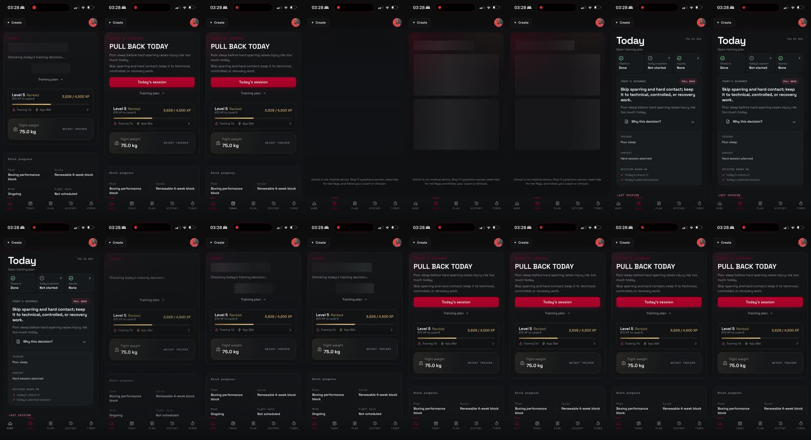
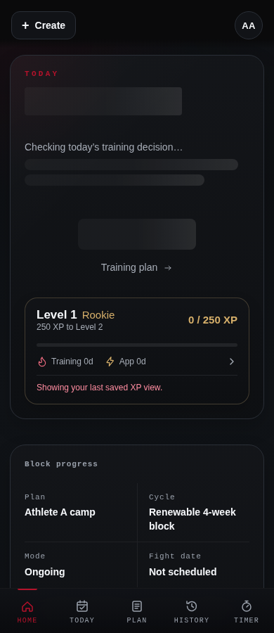
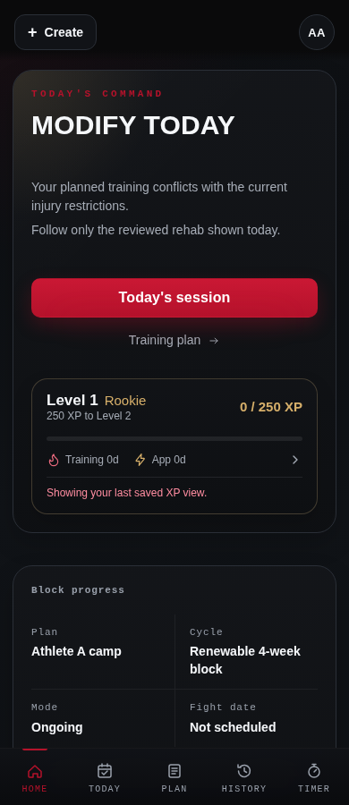
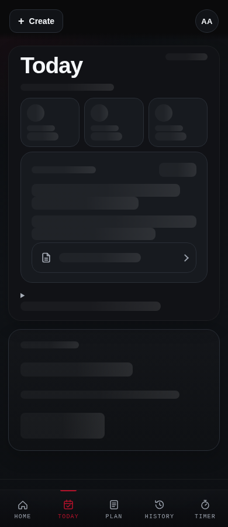
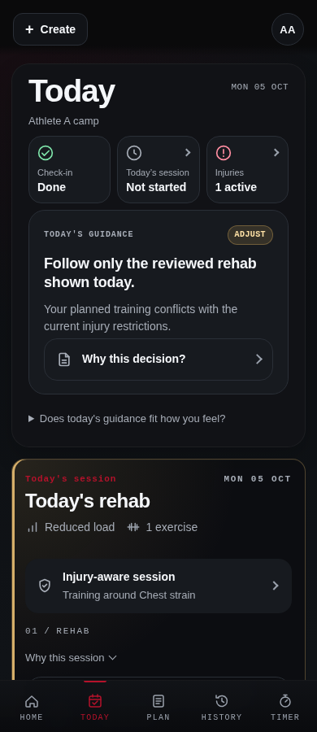
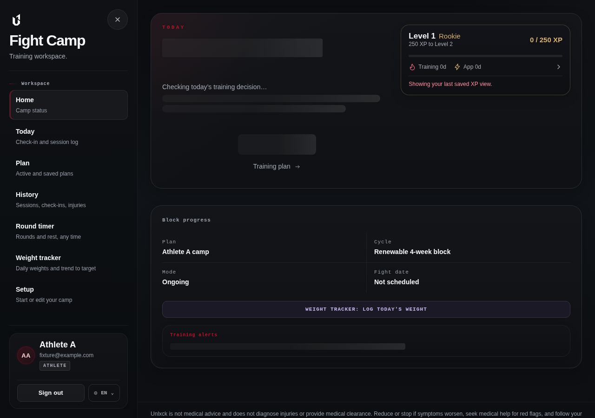
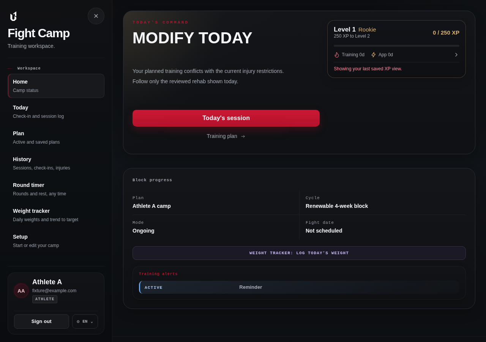
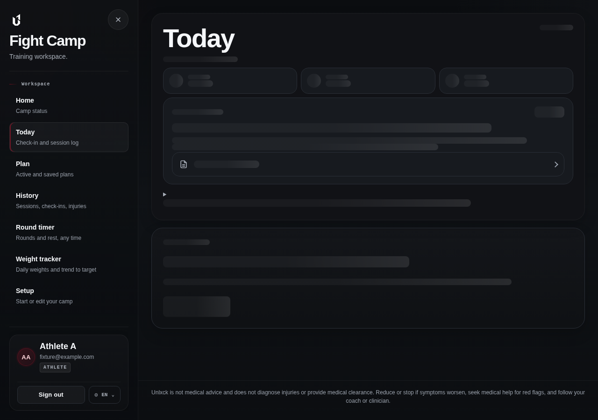
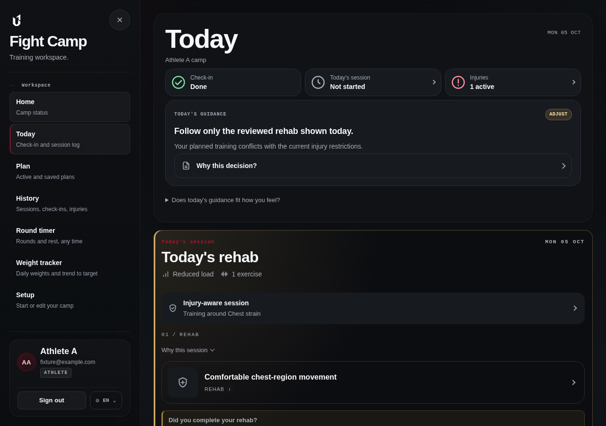

# Stable loading transitions

Based on Main 22848dbb and merged PR #3201. Fresh Today reads and safety gating are unchanged.

Before: the supplied iPhone recording shows the short Home placeholder pushing XP/weight downward and Today's two large rectangles being replaced by a different layout.

After: synthetic authenticated athlete, production Next server, system Chromium, 390×900 and 1280×900. Browser plugin unavailable; Playwright used. API responses delayed 1800ms **in the test only** to capture pending states. These screenshots use different data from the supplied recording.

| Surface | Loading | Loaded |
| --- | --- | --- |
| Home mobile |  |  |
| Today mobile |  |  |
| Home desktop |  |  |
| Today desktop |  |  |

## Validation

- Production build and typecheck pass; nine Today component tests pass.
- Targeted ESLint: no errors; existing Home effect warnings.
- Four production browser cases pass: mobile/desktop geometry, fresh-read gating, failed-read/retry.
- Home companion's vertical displacement <2px after the existing entrance finishes.
- Today heading displacement <2px; command shell height difference <8px in the tested fixture. No horizontal overflow.
- Geometry checks use reduced motion; screenshots cover loading/loaded structure. Content reveal is opacity-only, 180ms, disabled with reduced motion. Today's existing banner entrance is suppressed locally to avoid a second animation.
- No production timers, network requests, caching, freshness or error handling changed. The 250ms delay is removed only from Today's loading shell and its skeleton children.
- FadeThroughProvider, PageTransition, full-screen timer/preview/navigation transitions untouched.

Limits: Chromium mobile viewport emulation, not real iPhone Safari. Optional check-in forms, expanded safety evidence, longer guidance and consent-dependent sections can change the page's final length; placeholders do not invent or replay decisions to predict those sections. The geometry test measures element positions, not a real-device field CLS score.
